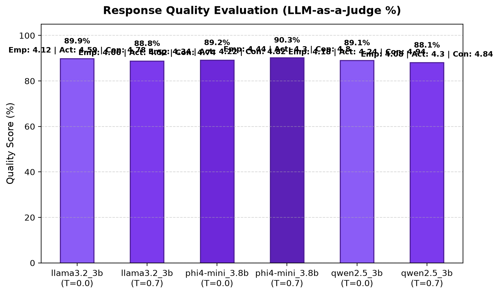
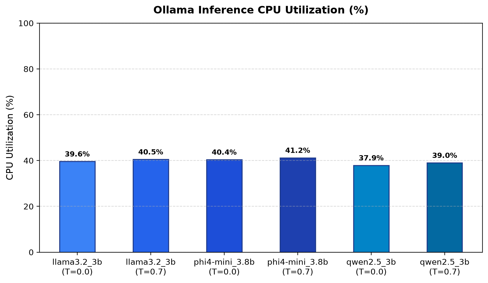

# Model Comparison Benchmark Study

This report evaluates local small language models (SLMs) on offline customer triage tasks using Ollama.

---

## 1. Throughput & Latency Performance

  
  

| Model          | Temp | Tokens/sec | Avg TTFT (s) | Avg Latency (s) | Avg Out Tokens |
| -------------- | ---- | ---------- | ------------ | --------------- | -------------- |
| llama3.2_3b    | 0.0  | 7.44       | 3.628        | 14.81           | 108.3          |
| llama3.2_3b    | 0.7  | 7.63       | 3.025        | 14.18           | 108.2          |
| phi4-mini_3.8b | 0.0  | 6.70       | 3.422        | 14.90           | 98.2           |
| phi4-mini_3.8b | 0.7  | 6.69       | 2.990        | 14.60           | 97.6           |
| qwen2.5_3b     | 0.0  | 8.12       | 3.238        | 11.84           | 94.4           |
| qwen2.5_3b     | 0.7  | 8.40       | 2.906        | 11.33           | 95.2           |

---

## 2. Reliability & Schema Adherence

| Model          | Temp | Tests | 1st Pass | Retry Pass | Failed | Pass Rate (%) |
| -------------- | ---- | ----- | -------- | ---------- | ------ | ------------- |
| llama3.2_3b    | 0.0  | 50    | 46       | 3          | 1      | 98.0%         |
| llama3.2_3b    | 0.7  | 50    | 48       | 2          | 0      | 100.0%        |
| phi4-mini_3.8b | 0.0  | 50    | 50       | 0          | 0      | 100.0%        |
| phi4-mini_3.8b | 0.7  | 50    | 50       | 0          | 0      | 100.0%        |
| qwen2.5_3b     | 0.0  | 50    | 49       | 1          | 0      | 100.0%        |
| qwen2.5_3b     | 0.7  | 50    | 48       | 2          | 0      | 100.0%        |

---

## 3. Decision Quality & Accuracy (Ground Truth & LLM Judge)

  
  

| Model          | Temp | Overall Accuracy (%) | Category Routing (%) | Escalation Match (%) | Judge Quality (%) |
| -------------- | ---- | -------------------- | -------------------- | -------------------- | ----------------- |
| llama3.2_3b    | 0.0  | 73.4%                | 72.0%                | 88.0%                | 89.9%             |
| llama3.2_3b    | 0.7  | 76.6%                | 78.0%                | 88.0%                | 88.8%             |
| phi4-mini_3.8b | 0.0  | 77.2%                | 82.0%                | 84.0%                | 89.2%             |
| phi4-mini_3.8b | 0.7  | 75.0%                | 84.0%                | 82.0%                | 90.3%             |
| qwen2.5_3b     | 0.0  | 76.2%                | 76.0%                | 86.0%                | 89.1%             |
| qwen2.5_3b     | 0.7  | 75.6%                | 76.0%                | 88.0%                | 88.1%             |

*Overall Accuracy is a unified weighted composite score calibrated across triage requirements: 40% Department Routing (Category), 30% Human Escalation (`requires_human`), 20% Queue Priority, and 10% Customer Sentiment. Judge Quality evaluates empathy, actionability, and conciseness.*

---

## 4. Resource Footprint (Memory & CPU Utilization)

  
  

| Model          | Temp | Avg Ollama RAM | Peak Ollama RAM | Avg Ollama CPU (%) |
| -------------- | ---- | -------------- | --------------- | ------------------ |
| llama3.2_3b    | 0.0  | 2598.0 MB      | 2598.8 MB       | 39.6%              |
| llama3.2_3b    | 0.7  | 2599.3 MB      | 2601.3 MB       | 40.5%              |
| phi4-mini_3.8b | 0.0  | 3284.5 MB      | 5301.5 MB       | 40.4%              |
| phi4-mini_3.8b | 0.7  | 2725.8 MB      | 3109.6 MB       | 41.2%              |
| qwen2.5_3b     | 0.0  | 2221.2 MB      | 2222.1 MB       | 37.9%              |
| qwen2.5_3b     | 0.7  | 2222.1 MB      | 2223.3 MB       | 39.0%              |

---

## Key Observations

- **Throughput & Speed Champion**:
  `qwen2.5_3b` achieved the highest inference throughput (**8.12–8.40 tokens/sec**) with the lowest average latency (~11.3s), outperforming both `llama3.2_3b` (~7.4–7.6 tokens/sec) and `phi4-mini_3.8b` (~6.7 tokens/sec).
- **Decision Quality & Routing Accuracy**:
  `phi4-mini:3.8b` maintains the highest triage routing accuracy (**82–84% category accuracy** and **75–77% overall weighted score**). `qwen2.5:3b` is closely competitive at **~76% overall accuracy** and **76% category routing**.
- **LLM Judge Response Quality**:
  All three models achieved strong response quality scores (~88–90%) evaluated by Flow-Judge across empathy, actionability, and conciseness, with `phi4-mini` peaking at **90.3%**.
- **Schema Reliability**:
  `phi4-mini:3.8b` and `qwen2.5:3b` demonstrated exceptional schema adherence (98–100% first-pass rate with 0–1 retries), whereas `llama3.2:3b` required more frequent retries to repair schemas.
- **Resource Footprint (RAM & CPU)**:
  `qwen2.5:3b` has the leanest memory footprint (~2.2 GB RAM), while `llama3.2:3b` requires ~2.6 GB and `phi4-mini:3.8b` consumes 2.7–3.3 GB. All three models saturated ~38–41% normalized CPU across 8 logical cores during inference.
